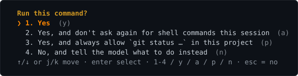

# Corbie Nest documentation

This is the full reference. For building and a quick start, see the [README](README.md).

## Usage

```
corbienest [options] [-p PROMPT]
  -m, --model NAME     model that does the work (default: saved / first tool-capable Ollama model);
                       anthropic:MODEL or claude:MODEL uses the Anthropic API (ANTHROPIC_API_KEY)
  -H, --host URL       ollama host (default $OLLAMA_HOST or http://127.0.0.1:11434)
  -c, --ctx N          context window (num_ctx, default 32768; accepts 64k, 128k, default)
  -s, --system TEXT    extra system instructions
  -p, --prompt TEXT    non-interactive: run one prompt and exit (add --yolo to allow tools)
      --output-format text|json|stream-json   with -p: plain reply (default), one JSON object, or JSON lines as it happens
      --input-format text|stream-json   with stream-json output: requests read as JSON lines from stdin, one request each
                       {result, session_id, model, prompt_tokens, eval_tokens, model_calls, tool_calls, advisor_calls, duration_s}
  -y, --yolo           auto-approve tool calls (same as --mode auto)
      --mode NAME      permission mode: manual, accept-edits, plan, auto
  -T, --no-tools       disable tool calling
      --continue       resume the latest session started in this directory
  -r, --resume [ID]    resume a session: by ID, or pick one from a menu
      --keep-alive DUR how long Ollama keeps the model loaded between requests (default 30m; -1 forever, 0 unload, default = server's)
      --no-memory      don't update .corbienest/memory.md after requests
      --no-web         don't offer web_search/web_fetch (the model cannot look documentation up)
      --think / --no-think / --show-thinking
      --effort LEVEL   how hard the model thinks: one of the levels it has (off, on, low, medium, high, … — see /effort); default = the model's own
      --advisor MODEL  a stronger model the agent may consult through the advisor tool (see /advisor); off = none;
                       xai:MODEL, openai:MODEL, anthropic:MODEL for a hosted one (key from XAI_API_KEY, OPENAI_API_KEY, ANTHROPIC_API_KEY)
      --advisor-guidance LEVEL   how much the agent leans on it: light, normal (default), strong, max (see /advisor guidance)
      --draft N        draft_num_predict: speculative-decoding / MTP draft tokens per step (0 = off; default: the model's own,
                       e.g. models that ship an MTP head set 4); changing it makes Ollama reload the model
      --benchmark [N]  measure tokens per second at every context size the model supports (or just the -c size):
                       per size a warm-up (model load time, GPU placement) then N timed runs (default 3) of a fixed
                       prompt (or -p PROMPT) capped at 256 tokens; prompt-eval and generation tok/s per size;
                       --output-format json for one JSON object
  -h, --help / -v, --version
```

```
$ corbienest --model qwen3.8 --benchmark 1
benchmark  qwen3.8 · 1 run × 256 tokens per context size · draft 4 (model default, MTP/speculative) · http://127.0.0.1:11434
  ctx    load     placement                 prompt eval    generation              first token
  4k     6.1s     100% GPU (17.3 GB)        441 tok/s     60.2 tok/s               0.36s
  8k     5.9s     100% GPU (17.3 GB)        441 tok/s     56.7 tok/s               0.37s
  16k    5.9s     100% GPU (17.3 GB)        439 tok/s     45.7 tok/s               0.36s
  32k    5.9s     100% GPU (17.4 GB)        437 tok/s     58.2 tok/s               0.37s
  64k    7.7s     89% GPU (16.5/18.6 GB)    342 tok/s     33.7 tok/s               0.40s
  128k   8.8s     66% GPU (13.9/20.9 GB)    205 tok/s     15.4 tok/s               0.50s
  256k   19.1s    41% GPU (11.0/27.1 GB)    137 tok/s      9.5 tok/s               0.63s
```
(The row where the placement drops below 100% is where the KV cache stopped fitting in VRAM — the
largest context you can run at full speed is the row before it. With several runs per size the
generation column also shows the min–max spread; a size that fails to load is reported and the
larger ones skipped.)

You need [Ollama](https://ollama.com) running (`ollama serve`) with at least one model pulled.
For the agentic features (files, shell, git) pick a model with **tool** support, e.g.
`ollama pull qwen3-coder:30b`, `qwen2.5-coder`, `devstral`, `llama3.1`, `gpt-oss`.

The screen is described in the README's features. The notes below cover the parts you use
without thinking about them: the status bar, the field, and the strip.

- The bottom of the screen is the app's: an input field (a rounded box with the `❯` prompt inside it,
  green while it waits), with the permission mode on its lower edge, right-aligned.
- The status bar, on the last row, shows the model (its provider prefix and `:latest` tag dropped),
  the tokens used this session (↑ prompt · ⟳ cache hits, when a hosted model had them · ↓ generated),
  and context usage. On the right, the working folder and the git branch, in a muted pink.
- Between the field and the status bar, a strip lists the running sub-agents. `↓` on an empty
  line goes into it; `↑`/`↓` move, Enter opens the agent's log, Esc returns to the field.
- The field grows with what you type (up to ten rows, then it scrolls). What you send moves up
  into the transcript as a `›` line.
- On exit your shell is back exactly as it was (use `/save` to keep a transcript).

## Slash commands

| command | what it does |
|---|---|
| `/model` | interactive picker of the local models and the Anthropic models (↑/↓, type to filter, Enter; xAI and OpenAI are advisors only and are not listed). Typing `/model` completes a local name, an Anthropic model (`anthropic:ID`, found by what is typed), or `anthropic:` / `claude:` and that key's models — `/model NAME` switches directly, and `anthropic:NAME` or `claude:NAME` makes that Claude model the one that does the work (`ANTHROPIC_API_KEY`) |
| `/models` | list installed models with tool/thinking capabilities |
| `/clear` | new conversation |
| `/compact` | have the model summarise the conversation to free context |
| `/memory [on\|off\|clear\|update\|every N\|idle N]` | show the project memory (`.corbienest/memory.md`), toggle its automatic update, run the pending update now, set how often it runs (default every 5 requests, plus after 15s idle at the prompt and at exit/`/clear`/`/compact`), how long the prompt must sit idle before a pending update runs (`idle off` waits for exit), or delete it |
| `/status` | model, context usage, settings |
| `/diff [git args]` | show `git diff` of the working tree (stat, patch, untracked files) for you only — nothing is added to the conversation; `/diff --staged`, `/diff HEAD~1` … pass through |
| `/rewind` | (or **Esc Esc** at an empty prompt) pick an earlier request and go back: undo the file changes the model made since (files are checkpointed before every `write_file`/`edit_file`), truncate the conversation to just before it (the request text returns to the editor), or both |
| `/orchestrate REQUEST` | the advisor model in charge: it plans the request as tasks, the main model does them as workers — several at a time where the plan allows — and the advisor reviews each; see [Orchestrating](#orchestrating) |
| `/plan REQUEST` | `/orchestrate` in layers: the advisor plans the request as tasks grouped into layers (`LAYER: n`), you approve the plan, then each layer runs and the project is built before the next one starts; a failed build becomes a fix task. See [Planning in layers](#planning-in-layers-plan) |
| `/workers [N]` | how many tasks of `/orchestrate` may run at the same time (default 3, at most 20, `1` = one after another) |
| `/goal "METRIC" [min\|max] [-n R] [-k K] [-m MODEL,…] GOAL` | candidates in git worktrees race to a metric, each on its model; the best score is kept and applied |
| `/cost` | tokens, model calls, tool calls, model time and wall time of this session |
| `/usage`, `/usage price MODEL IN OUT\|default` | tokens per model in this session — the main model, the advisor — and the **estimated cost** of the hosted ones. The providers' prompt-cache hits (`⟳ cache … read`) are priced at their cached-input rate — Anthropic's a tenth of the input price (5% or 2.5% on the newest models), OpenAI's and xAI's as their price lists give it for each model — and Anthropic's cache writes at 1.25×; they are shown on their own line, as `↑` is the input that was not from the cache. The list price per million tokens (built in, as of October 2026) or the one you set with `price`. The same estimate is on each consultation's result line (`⎿ advice · 4.2k tokens · 12s · ≈ $0.03`) and in `/cost`. An estimate: what was billed is on the provider's usage page. On a full-screen conversation `/usage` comes up as a centred window and the running request goes on underneath its output is held back until the window closes (Esc or Ctrl-C closes it); Anthropic's last reply also reports its live rate limits (`limits at its last reply: input … of … a minute`, from the `anthropic-ratelimit-*` headers). The Admin Usage & Cost API (organization totals, needs an admin key) is not used |
| `/banner` | the Corbie Nest box again: the crow, the model, host, advisor, mode and folder, as a window in the middle of the screen. It opens at startup and animates while it is up; close it with its **[×]** button (in the top border, two cells left of the corner) or Esc; sending a line closes it too. Its one line stays in the transcript |
| `/system [text\|clear]` | extra system instructions |
| `/think on\|off\|auto`, `/think show\|hide` | *when* a thinking-capable model thinks: `auto` (default) lets it think about each request once and turns thinking off for the tool rounds that follow, `on` thinks on every call, `off` never. *How hard* is `/effort` (`/think low\|medium\|high\|max` still works, as an alias for it) |
| `/effort [LEVEL\|default]` | how hard **this model** thinks, in the levels it has — see [Effort](#effort). No argument opens a picker of them; `default` leaves it to the model. Kept per model, shown next to the model's name in the status bar. Given while the model works, it applies when the turn ends |
| `/advisor [MODEL\|off]`, `/advisor guidance [LEVEL]`, `/advisor effort [LEVEL]`, `/advisor window MINUTES\|off`, `/advisor ctx N\|auto` (given while the model works: `ctx` applies at the next consultation, `guidance` and `window` when the turn ends) | a stronger model the agent may consult when the work is hard — see [The advisor](#the-advisor). No argument opens a picker of the installed models (a cloud or hosted model is set by name: `/advisor gpt-oss:120b-cloud`, `/advisor anthropic:claude-opus-5`). `guidance` says how much the agent leans on it (`light`, `normal`, `strong`, `max`), `effort` how hard it thinks |
| `/subagent [MODEL\|default]`, `/subagent effort [LEVEL\|default]` | the model the sub-agents (`task`) run on. Default: the model doing the work. Another one is checked with its server first (a local model, Ollama's cloud, or a hosted `anthropic:`/`xai:`/`openai:` model) and then kept in the config as `subagent=`. `effort` sets how hard that model thinks, in its own levels (kept per model, as `/effort` does; the same model as the one doing the work shares its effort). Given with a model, it waits for the turn to end, like `/model`. See [Sub-agents](#sub-agents) |
| `/hooks [add pre\|post TOOL COMMAND \| add start\|stop COMMAND \| remove N \| clear]` | the project's hooks: shell commands before or after a tool call, at start and at the end of a request. See [Hooks](#hooks) |
| `/mcp [add [-g] NAME COMMAND [ARGS…] \| remove NAME \| reconnect]` | external programs that offer tools, over the Model Context Protocol (stdio). See [MCP servers](#mcp-servers) |
| `/agents [reload]` | the sub-agent files of this project and yours: roles the main agent starts by name with `task` (see [Sub-agent files](#sub-agent-files)) |
| `/sandbox [on\|off]` | the model's shell commands in bubblewrap: the project directory writable, the rest read-only, a private `/tmp`, the network as it is. Off by default (`sandbox=bwrap` in the config). See [Sandbox](#sandbox) |
| `/permissions [add …\|remove N\|clear]` | the project's saved rules: "always allow" ones, and the guard rules `deny` and `ask` (see [Guard rules](#guard-rules-deny-and-ask)). Kept in the config directory, `permissions/`, keyed by the project's path — a file in the project itself is never read |
| `/mode [name]` | permission mode: `manual`, `accept-edits`, `plan`, `auto` (Shift+Tab cycles) |
| `/yolo [on\|off]` | shortcut for `/mode auto` / `/mode manual` (careful) |
| `/ui [ansi\|notcurses]` | the screen; restarts into this session |
| `/ui theme [NAME]` | the colour theme: a picker of the themes (the one in use marked), or the named one; saved, and the screen takes it at once |
| `/init` | have the model explore the project and write an `AGENTS.md` (build/test commands, architecture, conventions); improves an existing one |
| `/skills [reload\|new NAME]` | list skills; run one with `/NAME [args]` |
| `/tools on\|off` | enable/disable tools |
| `/web [on\|off\|engine URL]` | whether the model may look documentation up with `web_search`/`web_fetch` (on by default; saved), and which search engine it uses (`%s` = the query; `/web engine default` restores DuckDuckGo) |
| `/max_iters [N]` | how many tool rounds one request may run before the loop guard stops it (default 100). Takes effect at once, so it can be raised from under a turn that is about to hit it |
| `/ctx [N\|Nk\|max\|default]` | context window: no argument opens a size picker (up to the model's trained maximum), `/ctx 64k`, `/ctx max` … set it directly |
| `/temp X`, `/host URL` | tuning |
| `/keepalive [DUR]` | how long Ollama keeps the model loaded after a request (default `30m`, so it is not reloaded from disk mid-session; `-1` = forever, `0` = unload right away, `default` = the server's 5 minutes) |
| `/save [file]` | save transcript as markdown |
| `/resume [ID\|all]` | pick an earlier session to continue (this directory; `all` for every directory), or load one by ID. Its conversation is shown again as it was, and the lines you typed in it go into the ↑ history |
| `/history [N]` | show the last N queries (default 20; the latest 100 are kept across sessions, ↑/↓ recalls them) |
| `/cd DIR`, `/pwd` | change working directory |
| `/quit` | exit (also Ctrl-D, and a typed `exit`). The model can end the program too: when you say you are leaving ("bye", "that's all"), it replies with a goodbye and calls its `exit` tool, and the program ends after that reply |

## Input tricks

- `!cmd` — run a shell command yourself; its output is added to the conversation. The line is
  completed the way a shell would do it: where a command goes (the first word, or after `|`,
  `;`, `&&`) the programs in `$PATH` that start with what you typed are listed, the shortest
  first; any other word is offered the files and directories whose name starts with it —
  found wherever they are below the working directory, as for `@` (`!cat term` → `src/term.c`),
  and `!ls src/` lists `src`. Lines you ran before that go on from what you have typed come
  first, so a bare `!` shows your last shell commands. Nothing is offered inside quotes.
- `@path` — attach a file (or a directory listing) to your message. You do not have to know
  the path: while you type, the files that match the name so far are listed under the input
  field — `@term` finds `src/term.c`, wherever it is (a name that starts with what you typed
  first, then one that contains it, then one with its letters in that order). A directory in
  front says where to look, also outside the working directory: `@../lib/pa` searches below
  `../lib`, `@src/` lists `src`. Tab completes, ↓ steps into the list, Enter takes the
  highlighted file, Esc closes it. A bare name sent as it is (`@term.c`) is attached when
  exactly one file has it; when several do, they are named and none is guessed.
- `/` — the commands that match what you have typed are listed the same way, each with what
  it does, and after the command its options (`/mode ` → `manual`, `accept-edits`, `plan`,
  `auto`; `/effort ` → the levels this model has; `/cd ` → directories). The list is a preview
  until you step into it: Enter still sends what you typed.
- All three lists come up **while the model works** as well, for what you are typing ahead:
  `/` shows the commands, Tab completes, ↓ steps in and Enter takes the highlighted row. There
  Esc closes the list first; it is the Esc after that one which stops the model.
- `# fact` — remember something: a menu asks which section of `.corbienest/memory.md` it belongs
  to (Project / User / Feedback / Reference) and the line is appended, no model call involved.
- **Code is highlighted.** A fenced block in a reply is coloured by its language (`` ```python ``, `c`, `js`, `sh`, `json`, … — keywords, strings, comments and numbers, basic; a block without a language is plain), and so is the preview of a file the model writes, by the file's extension. The colours are escapes only, so the text and its wrapping are unchanged.
- Enter sends; Alt+Enter, Ctrl+J or a trailing `\` inserts a newline. Bracketed paste works.
- A paste of more than three lines (or 800 bytes) is shown as a token, `[Pasted text #1 +44 lines]`,
  in reverse video. A click on it opens the text in a scrollable window (↑/↓, PgUp/PgDn, Home/End,
  the wheel; Esc closes it). Backspace or Delete on the token removes all of it, and the whole text
  is what is sent. **Ctrl-O** unfolds the token the caret is on (or just after) into the field: its
  text then sits there to be read and edited, and is sent as it stands. Notcurses has no paste
  tokens: there a paste goes into the field as plain text, its line breaks kept (Enter does not send it).
  A paste typed in while the model works is kept as plain text, not as a token.
- Ctrl-C (or Esc) cancels a running generation / clears the line (twice on an empty line quits).
- **Tool results are folded.** What `grep`, `cat` or a build prints is for the model; in the
  transcript a result of more than one line is a single line — `▸ 42 lines · how it begins` — and
  a **click on that line** shows the rest (`▾`), another click hides it again. It works at the
  prompt, scrolled back and while the model is working. Without the full-screen UI (`-p`, a pipe)
  the first lines are shown instead, as there is nothing to click.
- **Multi-line shell commands are folded too.** A `bash` command of several lines shows as its first
  line with `▸ (+N lines)`; a click shows the whole command (`▾`). A command that is about to be
  asked about is never folded: the confirmation shows it in full.
- The **mouse wheel** and PgUp/PgDn scroll back through the conversation (the alternate screen has
  no scrollback of its own, so corbienest keeps one) — at the prompt and while the model works:
  what arrives meanwhile is kept and shown when you scroll back down, and Esc returns to the
  output at once (it takes a second Esc to stop the model). While you are scrolled back a line
  under the conversation says which rows you are looking at and how to get back; the status
  bar stays what it is, so the mode, the tokens and what the model is doing remain in view. At the prompt ↑/↓ scroll too,
  Home/End jump, and Esc/Enter return to the prompt exactly as it was; anything you type
  returns as well and goes into your message. The wheel only scrolls the conversation: over
  the input field it does nothing, and ↑/↓ there are always the keyboard's (history, or the
  lines of what you are writing). While the model works, ↑ takes the queued messages back into the
  field first (one per line, to edit or send again); when the queue is empty it recalls your history,
  and ↓ steps forward again and brings back what you had typed. Ctrl-P/Ctrl-N do the same on the ANSI screen. corbienest asks the terminal for the mouse to get the wheel
  as a wheel — so **selecting text with the mouse needs Shift held down** (Option in iTerm2),
  as in any full-screen program.
  Esc twice at an empty prompt opens `/rewind`.
- **You can keep typing while the model works.** What you type shows up in the input field as
  you go (`❯ …▏`); press Enter to queue it as a message — add details,
  narrow the request, change the spec — the status bar shows `N queued`.
  **A queued message never stops the work in flight.** The running shell command, the tool calls
  of the round, a sub-agent and an advisor consultation all run to their end. The message waits
  and goes to the model at its next call: between tool rounds when the turn is still going, or as
  the next request once it has ended. Esc and Ctrl-C are what stop work. Queue as many as you
  like; they are sent in order, and a `/command` waiting for the end of the turn does not hold
  back the messages behind it. Ctrl-C hands queued text back to the editor instead of sending it.
  Text without Enter simply reappears in the prompt afterwards.
- Tab completes slash commands, their options, skill names, `@files` and the words of a `!line`; ↑/↓ browse history — the latest 100 queries are
  kept in `~/.config/corbienest/history` (`/history` lists them). Ctrl-R searches it
  incrementally (`(reverse-i-search)`, like bash): type to refine, Ctrl-R again for an older
  match, Enter keeps the match in the editor, Esc restores what you had.
- Shift+Tab cycles the permission mode, also while the model is working (it applies to the
  remaining tool confirmations of that turn); the current mode is shown on the field's lower edge.
- **Slash commands that only report or set something answer straight away while the model
  works** — they never become a queued message: `/help`, `/status`, `/cost`, `/diff`, `/history`,
  `/pwd`, `/skills`, `/memory`, `/mode`, `/yolo`, `/permissions`, `/tools`, `/max_iters`,
  `/think show|hide`, bare `/think`, `/effort` (bare: it prints the levels instead of opening the picker), `/advisor ctx`, bare `/advisor`, `/temp`, `/keepalive`.
  `/mode` runs at once on purpose: it is the switch you want while the agent is editing. The settings that change the prompt
  or the tool list — `/think LEVEL|on|off|auto`, `/effort LEVEL`, `/ctx N`, `/advisor guidance`, `/advisor window` — are accepted
  while the model works and applied when the turn ends (at the latest, when the next request starts): the running turn keeps the
  settings it started with, so the model's prompt cache is not rebuilt mid-turn. Each says "from the next request" when it is taken. A `/permissions add` or `/mode` typed mid-turn applies to the
  tool confirmations still to come, like Shift+Tab, and `/max_iters` to the rounds still to come. Everything that touches the conversation (`/clear`, `/compact`,
  `/rewind`, `/resume`, `/save`, `/system`, `/init`, skills), needs the server (`/model`,
  `/models`, `/ctx`, `/host`, `/memory update`) or asks a question stays queued until the turn ends.

## When something is drawn wrong

Terminals differ, and a drawing problem that shows in one and not in another cannot be fixed
from a description. corbienest can record what it draws and what the terminal sends it:

```sh
CORBIENEST_TRACE=/tmp/corbie.trace corbienest      # reproduce the problem, then quit
tools/trace_replay.py /tmp/corbie.trace --info     # sizes, layout changes, keys and mouse reports
tools/trace_replay.py /tmp/corbie.trace            # play it back, in a terminal of the same size
tools/trace_replay.py /tmp/corbie.trace --from 40 --step   # from 40 s on, one write per Enter
```

The trace is plain text, one record per line with its time: every write to the terminal, the
output held back while scrolled back, every byte read from it, and each change of layout. A
replay in another terminal shows whether the problem is in what corbienest wrote or in what
that terminal made of it; `--until SEC` stops at the moment in question and holds the picture.
**The file holds the whole conversation and everything you typed** — the session says so at the
top while it is being recorded, the file is created readable by you alone, and it is yours to
pass on or not. Say which terminal program you use: that is the one thing the trace cannot tell.

## In tmux

corbienest runs in a tmux pane like in any terminal, and nothing has to be configured:

- **The wheel scrolls the conversation** whether tmux's own `mouse` option is off or on. (An
  application that does not ask for the mouse gets the wheel as ↑/↓ keys from the terminal, or
  loses it to tmux's copy mode — of an alternate screen, which has no history to show.
  corbienest asks, so tmux hands the wheel over.)
- **Splitting, zooming or resizing the pane redraws at once**: the input field and the bar move
  to the new last rows and the conversation is laid out again for the new width, from
  corbienest's own scrollback, without waiting for a key.
- To select text with the mouse hold Shift (that is the terminal's selection, across panes), or
  use tmux's copy mode from the keyboard (`prefix [`): it shows what is on screen, so scroll
  corbienest back first to copy something older.
- Esc reaches a program in tmux only after tmux's `escape-time` (500 ms by default in tmux 3.4):
  `set -sg escape-time 10` in `~/.tmux.conf` makes Esc — cancel, back from the scrollback —
  as quick as outside tmux.

## Permission modes

| mode | file edits (`write_file`, `edit_file`) | shell (`bash`) | notes |
|---|---|---|---|
| `manual` (default) | ask | ask | |
| `accept-edits` | auto-approved | ask | |
| `plan` | not offered / denied | ask | the model is told to explore and present a plan instead of changing things |
| `auto` | auto-approved | auto-approved | the old `/yolo`; use with care |

Cycle with **Shift+Tab** at the prompt, or set one with `/mode NAME`, `--mode NAME`
(`--yolo` = `--mode auto`). The mode is saved to the config file.

### Guard rules: deny and ask

Besides the allow rules, a project can have **guard rules** that stop or ask about what the model
does, whatever the mode. They are `/permissions add deny|ask TOOL PATTERN`:

```
/permissions add deny bash rm *            never run an rm, in any form
/permissions add deny edit .env            never write the .env file
/permissions add deny edit *.pem           no key files
/permissions add ask bash git push*        ask before every push, even under --yolo
/permissions add deny fetch *.evil.com     no pages from that domain
```

- **TOOL** is `bash`, `edit` (write_file and edit_file) or `fetch` (web_fetch and web_search).
- **PATTERN** is a glob: `*` (and `**`) matches any text, a `/` included, `?` one character. It has to
  match the whole thing. For `edit` it is matched against the path (`~` expanded, `..` resolved,
  the project's own directory and any `./` taken off, so `src/../.env` is `.env`). For `fetch` a
  pattern without a `/` is matched against the host, one with a `/` against the whole URL. `web_search` is a fetch of the search engine's URL, so a `deny fetch` on the engine's host also stops searches.
- **bash** patterns are matched against the whole command and against each part of it: split at
  `;`, `|`, `&` and newlines, with a leading `NAME=value` and a path in front of the program
  dropped, so `cd x && rm -rf y` and `/bin/rm f` both match `rm *`. A command with a `$(…)` or a
  backquote that no pattern matches is **asked** about, since what is inside cannot be read.
- **deny** stops the tool in every mode, `--yolo` included, and the model is told why and not to
  retry a variant. **ask** prompts in every mode; its prompt has "yes, this once" and no "don't ask
  again", since a saved allow would never take effect against it. Run without a terminal (`-p`, a
  pipe), an ask is refused.
- **Precedence**: deny beats ask beats allow. The shell commands you type yourself with `!` are not
  checked: the rules guard the model.
- These are guardrails, not a sandbox: a command the rules do not name still runs with your
  permissions. A sandbox for `bash` is on the list.
- The rules are in the same per-project file as the allow rules; `/permissions` lists them as
  "deny bash matching …" and "ask bash matching …", and `remove N` works on them too.

## Hooks

A hook is a shell command that runs at a point of the work, set by you for the project: it can
look at a tool call before it runs and stop it, look at its result, or run when corbienest starts
or a request ends. They are kept in the config directory, like the permission rules, and never read
from the project: a cloned repository cannot put commands in front of you.

```
/hooks add pre bash <command>      before a bash call, for every bash call
/hooks add post edit_file <command>
/hooks add start <command>         when corbienest starts (at a terminal)
/hooks add stop <command>          when a request ends
/hooks                             the list; /hooks remove N; /hooks clear
```

- **pre TOOL COMMAND** runs before a tool call. TOOL is a tool name or a glob (`*` for all, `bash*`).
  The hook reads the event on its standard input. **Exit 2 stops the call**: what the hook printed
  is the reason the model is given, and the call is not run. A timeout (60 s), an interrupt, or a
  hook that cannot run also stops it, as a precaution. Any other exit lets the call through.
- **post TOOL COMMAND** runs after the call. What it prints is added to the result, marked as a
  hook's note, so the model sees it (a linter's output, say).
- **start COMMAND** and **stop COMMAND** run when corbienest starts and when a request ends; what
  they print is shown. The start hooks run at a terminal only, not for `-p` or a pipe; the stop
  hooks run after every request, `-p` included.

The event is JSON on the hook's standard input: `{"event":"pre","tool":"bash","input":{"command":"…"},"cwd":"…"}`
(a post hook also has `"result"`). A hook that wants to block a `bash` call only when the command
matches, for example:

```
/hooks add pre bash sh -c 'grep -q "rm -rf" && { echo "no rm -rf here"; exit 2; }; exit 0'
```

- Hooks run for the model's tool calls, including those of sub-agents. The `!` lines you type are
  not hooked.
- A hook runs with your permissions, like any command you type: it is a command you chose to keep.
  A hook cannot allow what a guard rule denies: the hooks run first, and the guard rules are checked
  when the tool asks for its confirmation, so `deny` and `ask` still apply after a hook has passed the call.
- Hooks are guardrails, not a sandbox, the same as the permission rules.

## Background commands

A dev server or a watcher does not end, so `bash` can start one and return at once:
`run_in_background: true`. The result gives its id (`bg1`) and pid. The model reads what it prints
with `bash_job` (`action: output`), which returns only what came since the last read (at most 32 KB
at a time; when more has piled up, the older part is skipped and the result says how much), and says
whether the job is still running or what its exit code was. `bash_job` with `action: kill` stops it.

- The confirmation is the same as for a foreground command, and says *in the background*; the
  allow, ask and deny rules and the hooks apply to it as to any `bash` call.
- The output goes to a file in `TMPDIR`, not a pipe, so nothing has to be reading it while the model
  works. The job runs in its own process group, with no terminal and no access to corbienest's
  descriptors; Ctrl-C at the prompt does not reach it.
- Up to 8 jobs at a time. A finished job's place is given up when a new one needs it.
- The jobs belong to this running corbienest. `/resume` does not bring them back, `/ui` (which
  restarts the program) stops them, and so does quitting, or a SIGTERM or SIGHUP to corbienest.
  On Linux a SIGKILL to corbienest stops the job's shell; a process the shell started itself
  (a node server under `npm run dev`, say) can survive that.
- A sub-agent cannot start a background command: its conversation ends with its report, and nothing
  would read the job.

## Scripts: stream-json

`-p` with `--output-format json` gives one object when the run ends. `--output-format stream-json`
gives JSON lines while it runs, one object per line on stdout; what corbienest prints for people is
dropped, so the stream is only JSON. The lines are:

- `{"type":"system","subtype":"init","session_id","model","cwd","tools":[…]}` first;
- `{"type":"user","message":{"role":"user","content":"…"}}` for the prompt;
- `{"type":"assistant","message":{"role":"assistant","content":[{"type":"text","text":"…"},{"type":"tool_use","id","name","input"}]}}`
  for each model reply, with its tool calls;
- `{"type":"user","message":{"role":"user","content":[{"type":"tool_result","tool_use_id","content"}]}}`
  for each tool result;
- `{"type":"result","subtype":"success"|"error"|"interrupted","is_error","result","session_id","num_turns","duration_s","usage":{"input_tokens","output_tokens"},"model_calls","tool_calls"}`
  when the request ends.

A tool call the API gave no id (Ollama) gets one (`toolu_N_K`), and its result carries the same id.
`--input-format stream-json` reads requests from stdin, one JSON line each (`{"type":"user","message":{"role":"user","content":…}}`,
the content a string or a list of text blocks), and runs them in order; the session is the same
across them. Each request ends with its own result line. The `-p` prompt, if given, runs first.

```
printf '%s\n' '{"type":"user","message":{"role":"user","content":"list the TODOs"}}' \
  | corbienest --output-format stream-json --input-format stream-json --mode plan
```

Permission prompts cannot be answered in this mode, so a tool that needs one is refused unless
`--yolo` or the project's rules allow it.

## MCP servers

A Model Context Protocol server is a program that offers tools: a database, an issue tracker, a
documentation index. corbienest starts the ones you name, asks them what they offer, and gives the
model their tools next to its own, as `mcp__SERVER__TOOL`.

```
/mcp add docs npx -y @example/docs-mcp --root docs     start a server for this project
/mcp add -g tracker uvx tracker-mcp                    the same, for every project
/mcp                                                   the list: where each is kept, and what it came to
/mcp reconnect                                         start them all again
/mcp remove docs
```

- **Where they are kept.** In the config directory, `mcp/<project>.json` for this project and
  `mcp/global.json` for every project (`-g`): never in the project tree, since a cloned repository
  must not start programs. A name in both is the project's. The file is a JSON object,
  `{"servers":{"NAME":{"command":"…","args":["…"],"env":{"KEY":"value"}}}}`, which you can edit by hand.
- **How they run.** The command and its arguments are started as written, with no shell, in their
  own process group, with your environment plus the server's `env` (which replaces the same keys).
  `/mcp add` splits its arguments on spaces, so an argument with a space needs the file.
- **Connecting.** At start-up, and by `/mcp reconnect`, every server is started and asked for its
  tools (five seconds each to answer; the list pages are followed). `/mcp` shows each as
  `connected: N tools`, or why it is not connected.
- **Calls.** Each call is shown and approved like a shell command: its prompt offers "always allow
  this tool in this project", which saves `mcp NAME` as an allow rule, and the project's
  `deny mcp PATTERN` and `ask mcp PATTERN` guards match the tool's full name (for example
  `deny mcp mcp__docs__*`). Non-interactively a call is refused unless `--yolo` or a rule allows it.
  A call that takes more than two minutes is stopped; Esc stops it and sends the server a cancel.
- **Results.** The text blocks of a result are the tool's output; images and other kinds are named
  (`[image]`). A result the server marks as an error is an error for the model.
- **Not offered** in plan mode (a server's side effects are unknown to corbienest), to sub-agents,
  or to `/orchestrate` workers.
- **A server that dies** is reported as an error for the calls that reach it, and `/mcp reconnect`
  starts it again. Its process is stopped when corbienest exits, or before `/ui` restarts it.
- **Not yet**: servers over HTTP or SSE (stdio only), resources and prompts (only tools), and quoting
  in `/mcp add`.

## Sub-agent files

A sub-agent (see [Sub-agents](#sub-agents)) starts with the same instructions each time. A file
gives one a name, a role, and its own tools and model, and the main agent starts it with
`task` and `agent=NAME`.

```markdown
---
name: reviewer
description: Reviews a diff for bugs, read-only
tools: read_file, grep, bash
model: anthropic:claude-haiku-5
---
You review code. For each bug give the file, the line and the fix, and nothing else.
```

- **Where they are read.** `.corbienest/agents/NAME.md` and `.claude/agents/NAME.md` in the project,
  then `agents/NAME.md` in your config directory (for every project). The first file of a name is the
  one used. Claude Code's folder works as it is.
- **The frontmatter.** `name` (the file name, if left out), `description` (required: the main agent
  reads it to choose), `tools` (a comma list; left out, the agent has every sub-agent tool), and
  `model` (left out, or `inherit`, the sub-agents' model from `/subagent`). The body is the role,
  added to the sub-agent's instructions.
- **Claude Code files work as they are.** Its tool names are understood (`Read`, `Grep`, `Glob` and
  `LS` for `list_dir`, `Bash`, `WebFetch`, `WebSearch`), and its model aliases `sonnet`, `opus` and
  `haiku` mean the sub-agents' own model, since they are not models of your server. An agent whose
  `tools` name none of the sub-agent tools is refused when it is started, and `/agents` marks it
  `(none usable)`.
- **An unknown name** (`task` with `agent=NAME` for no file) is an error returned to the main agent,
  with the agents that do exist; nothing falls back to a general sub-agent by itself.
- **What an agent cannot do.** It has only the sub-agent tools (`read_file`, `list_dir`, `grep`,
  `bash`, `web_fetch`, `web_search`): a file can name fewer of them, never more. It cannot edit files,
  start a sub-agent or ask the advisor. Its shell commands and fetches are confirmed and checked by the
  rules and the hooks like anyone's. A file can change what an agent is asked to do, not what it is
  allowed to do.
- **A model of its own** is checked the way `/subagent` checks one, when the agent runs. It is a
  parameter of that run: `/subagent` and the config are not changed, and its tokens are priced as that
  model's.
- **`/agents`** lists the agents with their tools, model and file. `/agents reload` reads them again.
  The main agent's system prompt names them, rebuilt with every request, so a reload is seen at the
  next one.

## Sandbox

`/sandbox on` (or `sandbox=bwrap` in the config) runs the model's shell commands in
[bubblewrap](https://github.com/containers/bubblewrap), a program that gives a process its own view of
the filesystem. Off by default.

- **What the commands see.** The whole filesystem read-only, your home directory included. The
  project directory is writable (the one you started corbienest in), and so is a private `/tmp` that
  is empty and gone when the command ends. The network is the same as yours.
- **What it stops.** A command that writes outside the project fails with the program's own
  "permission denied" or "read-only file system". The config directory is read-only too, so the model
  cannot edit your rules, hooks or MCP servers from a command.
- **What it does not stop.** Reading: a command can still read anything you can read, `~/.ssh`
  included. Network: a command can still send what it reads. The sandbox limits writes and the
  filesystem's view, not what a process may do otherwise; the permission rules and the hooks still
  decide what runs at all.
- **What it breaks.** A tool that keeps a cache outside the project (`~/.cache`, `~/.npm`, a Go or
  Cargo build cache in your home) cannot write it, and fails or runs slower. Give it a cache directory
  inside the project, or run it with `!` (which is not sandboxed).
- **Which commands.** The model's `bash` calls, its background commands and those of its sub-agents.
  Not your own `!` lines (you are the user), not hooks, not MCP servers.
- **If it cannot start.** `bwrap` missing, or user namespaces refused (some hardened kernels and
  containers), is said once, before the command runs, with the reason; the commands then run without
  the sandbox, and `/sandbox` shows that it is not usable here. The check is one trial run, asked
  once.
- **Requirements.** `bubblewrap` installed (`apt install bubblewrap`) and unprivileged user namespaces
  allowed. Nothing else: no new dependency in corbienest.

```
/sandbox on          the model's commands are sandboxed from now on, saved in the config
/sandbox             shows whether it is on and usable here
/sandbox off
```

## Tools the model can call

| tool | confirmation |
|---|---|
| `read_file(path, offset?, limit?)` | none |
| `list_dir(path?)` | none |
| `grep(pattern, path?, include?)` | none |
| `write_file(path, content)` | yes — shows a preview |
| `edit_file(path, old_string, new_string, replace_all?)` | yes — shows a diff |
| `bash(command, timeout?, run_in_background?)` | yes — shows the command; output/exit code returned to the model. With `run_in_background` it starts the command and returns at once (see [Background commands](#background-commands)) |
| `bash_job(job, action)` | none — reads the output of a background command that `bash` started (`action` `output`: what it printed since the last read, and whether it runs; `kill`: stops it). See [Background commands](#background-commands) |
| `todo_write(todos)` | none — keeps the task list of the request, shown in the transcript and saved with the session. Send the whole list each time, with each task `pending`, `in_progress` (at most one) or `completed`; an empty list clears it. For work of three or more steps; the sub-agents do not have it |
| `web_search(query, max_results?)` | yes — shows the query and the engine; "always allow" saves the engine's **host** |
| `web_fetch(url, offset?, timeout?)` | yes — shows the URL; "always allow" saves the **host** |
| `task(description, prompt)` | none for the call itself — runs a **sub-agent**: a fresh, read-only agent loop (read_file, list_dir, grep, bash, web_search, web_fetch — with the usual confirmations) that investigates and returns a report as the tool result, keeping the noise out of the main context. Its tool calls are echoed as `⎿ grep(…)` lines and the report is previewed. Sub-agents cannot edit files or start further sub-agents. It runs on the model `/subagent` names, at that model's effort, and its tokens are priced as that model's |
| `advisor(question?)` | none — only on offer after `/advisor MODEL`. Puts the agent's question, and the conversation so far, to a **stronger model** (local, Ollama cloud, or a hosted API) and returns its advice as the tool result; see [The advisor](#the-advisor) |

Each confirmation is a small menu:



Move with ↑/↓ (or j/k) and press Enter, or hit `1`–`4` or the `y`/`a`/`p`/`n` shortcuts;
Esc or Ctrl-C means no. `p` saves a rule to the config directory (`permissions/`, per project; like Claude Code's
project allow-list): `edit` allows file writes/edits, `bash git status` allows shell commands
that start with those words (`git status --short` yes, `git status; rm -rf /` no — commands
with `; | & $ \` < >` never match a rule), `fetch www.postgresql.org` allows `web_fetch` to read
pages from that host (exact host, no wildcards — approve a manual once and read the rest of it
without being asked). `/permissions` lists the rules; `/permissions add
bash make`, `/permissions add fetch keycloak.org`, `/permissions remove N`, `/permissions clear`
manage them by hand. On "no" you can type what the model should do instead (Enter to skip)
and it is sent back as the tool result. Anything you typed while the model was still generating
is never taken as an answer — it is kept for your next prompt. Ctrl-C while a command runs kills it.

Some local models occasionally emit their native tool syntax as plain text
(e.g. `<function=grep>…`) when Ollama's parser fails; corbienest recognises the
Qwen XML and Hermes `<tool_call>{json}</tool_call>` shapes and still executes them.

## Reading documentation

Local models are confidently wrong about other projects' APIs: an admin endpoint that does not
exist, a `postgresql.conf` option from three major versions ago. These two tools give the model
the page instead of its memory of the page.

- **`web_search(query)`** — the top results as title, URL and snippet, for when it does not know
  where the documentation is. Default engine is DuckDuckGo's HTML endpoint; `/web engine URL`
  points it anywhere (`%s` is the query), so a self-hosted SearXNG works as well.
- **`web_fetch(url)`** — the page as readable text: scripts, styling and markup stripped,
  `<pre>` blocks kept as fenced code, links kept with their target so it can follow the docs to
  the next page. At most 24 KB per call, the rest paged with `offset`, so a long manual page
  cannot swallow the context window.

**Every session is told to use them.** One line of the system prompt corbienest builds for every
request: never guess at another project's API, options or errors — search for its docs, read
them, match the version this project actually uses (lockfile, manifest, image tag), say which
page you used, and skip the web when the repository answers the question. It is deliberately
one line: the two tools' own descriptions carry the rest, and a system prompt is re-sent with
every single call. Naming the doc sites you care about in `AGENTS.md` makes it concrete —
see [Project instructions](#project-instructions).

Pages come in through the `curl` (or `wget`) program, which already brings size caps and a
fallback for machines without it. Redirects are **not** followed: the page says where it moved,
and the new address is a `web_fetch` of its own, checked and confirmed like any other. Every
search and fetch is confirmed like a shell command — a search shows the query, which is what
leaves your machine — `http(s)` only, and cloud-metadata addresses (`169.254.169.254`,
`metadata.google.internal`) are refused outright. Approving a host once (`p`) covers the rest of
that manual, and the engine's host covers later searches. `/web off` (or `--no-web`) takes both
tools away.

A big page is often best handed to `task` — the sub-agent has both tools too, reads the manual
in its own context and reports back the three endpoints that matter.

## The end-of-task report

When the model is done with what you asked for it closes the turn with a short report: what it
did — the changes, the files they touched, and how it verified them (build, tests, running the
program, or that it did not) — and, when there is something worth raising, up to three
suggestions of what you may want to do next: follow-up work it left out on purpose, a weakness
it noticed nearby, something worth testing. Suggestions are only suggestions; it does not start
on them.

The report is meant to say *finished*, so it is asked for only when the work really is. When
something is left — a step skipped, a tool you denied, a build or test that failed, work stopped
partway — the model writes no report and says instead, in a line or two, what is done, what is
not, and what comes next. There is no report in plan mode either (the plan is the answer), nor
after a turn that only answered a question or stopped to ask you something. Small local models
follow all of this more loosely than large ones.

## Sub-agents

A sub-agent is a fresh agent loop that the model starts with the `task` tool to investigate one
self-contained question. It has read-only tools, works in its own context, and returns one
report, so the main conversation only sees the answer. By default it runs on the model doing the
work. `/subagent` changes that, separately from the main model:

```
/subagent qwen3-coder:30b          a local model, fast enough to read a lot
/subagent anthropic:claude-haiku-5 a hosted one, for the reading (ANTHROPIC_API_KEY)
/subagent effort low               how hard that model thinks, in the levels it has
/subagent default                  back to the model doing the work
```

- A model is asked of its server when it is set (`/subagent` refuses a name the server does not
  know), and its levels are read then, so `/subagent effort` can check them.
- Its tokens go to `/usage` under its own name, so a cheap reading model shows up as one, with
  its price.
- The setting is saved (`subagent=` in the config), so it holds for the next session as well.
- Sub-agents still have no edit tools and cannot start sub-agents or ask the advisor, whatever
  model they run on.
- **The strip** above the status bar lists the running sub-agents, one row each, with the
  round they are on and what they are doing right now. `↓` on an empty line goes into it,
  `↑`/`↓` move, and Enter opens the picked agent's log. Esc or a typed key returns to the field.
  It works while a turn runs too, where keys are read from the raw input. Notcurses shows the
  same strip.
- **← on an empty prompt line** opens the list of this session's sub-agents (newest first, each
  with its state and rounds, or what a running one is doing now) and the main agent. Picking one
  shows its log as an open block at the top of the scrollback: its task, each tool call and the
  head of what it returned, and the report. Esc returns to the prompt. The log is kept for the
  last 16 runs, 96 KB each, in memory only; while a sub-agent runs, its tool calls are also
  echoed live, and PgUp/the wheel scroll back to them.

## Choosing between options

When the model sees two or more reasonable ways to do the work, it ends its reply with the
options as a short list, the one it recommends marked:

```options
- [recommended] Advisory lock — survives a crash, needs flock
- Lock file — simple, but a crash leaves it behind
```

corbienest reads that block when the reply is finished and offers the options as a picker, with
the recommended one under the cursor: ↑/↓ to choose, Enter to take it, Esc to take none. The
choice goes back to the model as your next message (`Go with this: Advisory lock — …`), so the
work carries on with the option you picked. The picker only comes up when no message is queued
behind the reply, and in a plain pipe (`-p`) nothing is offered, as there is nothing to choose
with. The model is told to use the block only for a real choice between approaches; for
anything it can decide itself it just does the work.

## Skills

A skill is a reusable instruction file, `SKILL.md`, with a short frontmatter:

```
---
name: review
description: Review the given files for bugs and style problems
---
Review these files carefully: $ARGUMENTS
Report findings as a list.
```

An optional `model:` line names the model the skill runs on when it is a role of a plan (see [Orchestrating](#orchestrating)); without it the role runs on the model in use.

Put project skills in `.corbienest/skills/NAME/SKILL.md` (or `NAME.md`; `.claude/skills/` is
read too), personal ones in `~/.config/corbienest/skills/`. Claude Code's flat custom
commands are picked up as well: `.corbienest/commands/NAME.md`, `.claude/commands/NAME.md`,
`~/.claude/commands/NAME.md` (frontmatter optional — the file body is the prompt). Run one with `/NAME args` —
`$ARGUMENTS` is replaced by the arguments — or from the shell with `-p "/NAME args"`.
`/skills` lists them, `/skills reload` rescans, `/skills new NAME` scaffolds one. The
available skills are also listed in the system prompt so the model can pick one up itself.

Skills may ship helper programs next to `SKILL.md`. Write those in **C** (build with `cc`
or a small Makefile in the skill directory); use Rust only when a third-party library is
genuinely needed, and Python only as a last resort. The model is told the same rule when
asked to create a skill.

## Context window

The status bar shows how much of the context window (`num_ctx`, default 32k) the last request
used; the footer under a reply warns when it is nearly full. To grow it, run `/ctx` for a
picker of sizes up to the model's trained maximum (read from `ollama show`), or set one directly:
`/ctx 64k`, `/ctx 131072`, `/ctx max`, `/ctx default`. `/status` shows the model's maximum.
Larger windows need more RAM/VRAM and take effect on the next request; `/compact` is the other
way out when a long session fills up. Once a request has used 85% or more of the window,
corbienest compacts automatically before the next model call — also mid-task, between tool
rounds, and then the summary is handed straight back to the model, along with your request as
you made it, so it carries on with the job instead of stopping to ask what to do next.

## Sessions

Every conversation is saved after each request to `~/.config/corbienest/sessions/<id>.json`
(the latest 100 are kept). `corbienest --continue` picks up the most recent session started in
the current directory, `--resume` opens a picker (or `--resume ID`), and `/resume` does the same
from inside a session. The recap is followed by the conversation as it was: the last 200 messages, what you typed, the replies, and each tool result folded as it is live. The lines you typed go into the ↑ history (the ones already there are not added again). A one-shot run (`-p`) prints none of this and leaves the history alone. A session saved before this change has no record of what was typed, so every user message is shown and nothing goes into the history. `/clear` starts a
new session; `/status` shows the current id, which is also printed when you quit.

## Project memory

Like Claude Code's auto-memory: corbienest keeps `.corbienest/memory.md` in the working
directory and loads it into the system prompt of every request. The model curates it — every
few requests (default 5, `/memory every N`; after 15s idle at the prompt, `/memory idle N`;
also at exit, `/clear`, `/compact`, `/cd`) a quiet
extraction call asks whether the exchanges since the last update revealed anything durable
(who you are and how you like to work, feedback you gave, project goals/decisions/constraints
that aren't in the code, references such as URLs or tickets) and, if so, rewrites the file;
otherwise nothing is written. Facts the repository already records, and anything only relevant
to the current conversation, are deliberately not saved. Type `# fact` to add something yourself
in one keystroke, ask the model to remember
or forget something (it edits the file with `edit_file`), or edit the file by hand. `/memory`
prints it, `/memory off` (saved to config) or `--no-memory` disables the update, `/memory clear`
deletes it. One-shot runs (`-p`) only touch the file if `.corbienest/` already exists.

The extraction call is a real model call (the status bar shows `⠋ updating memory` while it
runs) and its cost is printed afterwards (`✎ memory: no change · 3.2s`). It never asks the
model to think and is capped in length (a cut-off reply is ignored rather than written). Its
different prompt evicts Ollama's prompt cache for the conversation, so the request after it
re-evaluates the whole context — which is why it is batched rather than run after every
request (`/memory every 1` restores that; `/memory update` runs a pending one now; `/memory`
shows how many requests are pending). On slow machines `/memory off` removes it entirely.

So that a pending update never holds up the way out, it also runs on its own once the prompt
has been idle for 15 seconds (`/memory idle N`, `/memory idle off`, saved to config): the call
happens while you read the reply, and by the time you quit there is usually nothing left to
write. Typing anything cancels it for that prompt — a request you start right away still finds
a warm prompt cache, and the batch simply waits for the next pause. The update is a model call
like any other, so Enter while it runs queues your message (`1 queued` in the status bar)
rather than sending it: it is sent the moment the write is done, without a second Enter. If you
do quit with an update still pending, the flush on the way out says so and Ctrl-C skips it.

## Project instructions

If an `AGENTS.md`, `CORBIENEST.md` or `CLAUDE.md` exists in the working directory it is
appended to the system prompt, so you can give the model project-specific guidance (up to
32 KB). `/init` writes a first one for you.

This is the place to say which upstream projects this code talks to and where their
documentation lives, so `web_fetch` lands on the right page and the right *version* of it:

```markdown
# Project instructions

We run Keycloak 26 behind PostgreSQL 17.

- Keycloak admin REST API: https://www.keycloak.org/docs-api/26.0/rest-api/ —
  the admin client lives in src/auth/. Check the docs before adding an endpoint.
- PostgreSQL settings and SQL: https://www.postgresql.org/docs/17/ — we are on 17,
  do not use syntax from 18, and do not trust your memory of default values.
- Look it up when you are unsure (web_search to find the page, web_fetch to read it)
  and say which page you used. Searching for "keycloak 26 <thing>" beats guessing.
```

Three other ways to add instructions: `-s "…"` / `/system …` for the session, a skill for
instructions the model should pull in on demand (see [Skills](#skills)), and
`.corbienest/memory.md`, which the model curates itself (see [Project memory](#project-memory)).

## Effort

Thinking models do not all think in the same way, so how hard one thinks is set **per model**,
in the levels that model has:

| model | `/effort` offers |
|---|---|
| gpt-oss | `low` · `medium` · `high` — it cannot stop thinking, so there is no `off` (`/think off` sends it `low`) |
| qwen3.8 | `off` · `low` · `medium` · `high` |
| most other thinking models (qwen3, deepseek-r1, …) | `off` · `on` |
| a model without the thinking capability | nothing — and it is never sent anything but `think: false`: the server refuses the rest |

Where the list comes from: Ollama 0.34.3 and later say which levels a model has
(`thinking.values` in `/api/show` — cloud models have their own, e.g. `low` · `high` · `max`), and
corbienest offers exactly those. Older servers only say *that* a model thinks; for them the
table above is built in, and any other thinking model is on/off. You can still give such a
model a level by name (`/effort high`) — it is passed on, and corbienest tells you the server
will take it as plain "on". `high`, `xhigh` and `max` all mean "as hard as it goes": one of
them that the model does *not* have is sent as the strongest level it does have, so a saved
`high` keeps working when a server upgrade renames the top level (qwen3.8's becomes `xhigh` in
0.34.3, where `high` would quietly mean medium).

`/effort` and `/think` work together: `/think` says **when** the model thinks, `/effort` **how
hard**. One thing to know: the models that have levels write the level into the *top* of the
prompt, so a level is sent with **every** call of a request — switching it off for the tool
rounds, as `/think auto` does for on/off models, would change the top of the prompt and make
the server read the whole conversation again, twice per request. If that thinking on every
tool round is too slow, pick a lower level rather than `/think auto`.

Capabilities are read from `/api/show`, not from the model list: `/api/tags` reports them as
they were when the model was pulled, so a model whose template has learned tools or thinking
since then (deepseek-r1, for one) shows up there as chat-only.

## The advisor

`/advisor MODEL` names a stronger model that the agent may **consult** while it works — a bigger
local model, one of Ollama's cloud models (`/advisor gpt-oss:120b-cloud`; run `ollama signin`
once, the local server relays the call), or a hosted API: xAI's Grok, OpenAI, or Anthropic's
Claude (see [Hosted advisors](#hosted-advisors)). As you type `/advisor ` the list under the input field offers the hosted providers (`xai:`,
`openai:`, `anthropic:` — typing `grok`, `chatgpt` or `claude` finds them too) and the installed
models, and behind a provider's prefix the models its key can use, asked from the provider's
own model list. Bare `/advisor` lists the three kinds, with
the key each hosted provider wants and whether it is set, and what `guidance` and `effort` do,
above its picker. The agent gets an `advisor` tool and is told
when to use it: before it commits to an approach for a non-trivial change, when an error has
survived two fixes or a result makes no sense, and before it calls a difficult task done. You
can also just say so: *"ask the advisor before you continue"*.

```
● advisor(parse() crashes on the input "1, 2,,3" - what is the smallest corr…)
  ⤷ advisor gpt-oss:120b-cloud · consultation 1 of 3 in this request · 2 KB of the conversation · esc skips it
    ⎿ advice · 930 tokens · 14s:
  ⎿  The crash is int("") on the empty field between the two commas. …
```

- **What the advisor sees.** Not just the question — a small model writes a poor brief — but the
  conversation itself, as one quoted text: your request, what the agent said, its tool calls and
  their results (long ones lose their middle; when it does not all fit, the newest part wins and
  the request always stays), plus the project's rules. It has **no tools**: it cannot read a
  file or run anything, it answers with advice, and the agent is told that where a file or a
  command contradicts the advice, they are right.
- **What it costs.** Time — and on one machine more than that: loading a second local model may
  push the main one out of memory, and its next reply then reloads it and reads the whole
  conversation again (corbienest says so when it happens). So a consultation runs in a window
  of its own (`/advisor ctx`, default the main window but at most 16k: a 70B model pays several
  times the memory per token that a small one does), the advisor is unloaded as soon as it has
  answered, and one request may consult it a limited number of times (**3** at the default
  guidance) — after that the tool answers with an error instead. A cloud or hosted advisor
  touches neither your memory nor the main model's prompt cache, which makes it the cheap choice
  on a small machine; it does mean the conversation is sent off the machine with each
  consultation.
- `/advisor effort LEVEL` sets how hard *it* thinks (the same levels as `/effort`, kept with its
  model; `/think` does not apply to it). Lower it if consultations run out of tokens while
  thinking. `/advisor MODEL` with the model already doing the work is allowed — a second opinion
  from a fresh context, not a stronger one.
- Enter with a message while it is consulted does not stop the consultation: the message waits
  for the next call. Esc skips it. Either way the turn carries on. Plan mode keeps the advisor — it changes
  nothing; sub-agents do not get it. Its tokens are part of the session totals, and `/cost`
  shows them on a line of their own.

### Guidance: how much the agent leans on it

A small model is a poor judge of when it needs help: it is sure of the wrong approach, and calls
a task done that is not. `/advisor guidance` (or `--advisor-guidance`) sets how much it leans on
the advisor — more tokens spent on advice, fewer spent on the agent going the wrong way:

| level | consultations per request | the agent is told to ask | advice | corbienest also asks |
|---|---|---|---|---|
| `light` | 1 | only when it is stuck | ≤ ~250 words | — |
| `normal` (default) | 3 | when the work is hard (above) | ≤ ~400 words | it is **brought in** when tool calls have failed two rounds in a row |
| `strong` | 6 | after reading the code and before committing to an approach, before each non-trivial change, when a build or test fails in a way it does not understand | ≤ ~700 words, concrete: file, function, the lines to change | that, and a **review** of a request that changed a lot before it ends: 40 changed lines or 3 files (git work and tool calls alone are not reviewed) |
| `max` | 10 | as `strong` | ≤ ~900 words, as concrete | as `strong`, but a **review** of any change before the request ends, and a **check** of the request's first change before it is made |

The limit is per request — one message of yours, however much work it sets off — and a request
that runs long gets its consultations again every **15 minutes**: `/advisor window MINUTES`
changes that (`off` = the limit holds for the whole request), `--advisor-window` does it for one
run, and it is saved as `advisor_window=`. When the limit is reached the agent is told how long
until it can ask again.

The review, the check and the stepping in do not count against the agent's consultations, and
each happens at most once per request (the stepping in once per window). The review measures what the agent did with its file tools (`write_file`, `edit_file`), against each file's state before the request's first write: an edit that was undone counts as nothing, and an edit made by a shell command (`sed`, a script) is not counted at all. A request that only runs git or reads code is never reviewed. They are what makes the advisor work with a small model: it
is told to ask, but a model that is going wrong rarely thinks so, and these do not wait for it. They enter the conversation the way a consultation does — as an
`advisor` call and its result — so the agent reads them as advice, not as something you said:

```
● write_file(src/parse.py)
  ⤷ advisor anthropic:claude-opus-5 · checks the first change before it is made · 6 KB of the conversation · esc skips it
    ⎿ advice · 2.4k tokens · 9s:
  ⎿  Not yet: the fix belongs in split_fields(), not in parse() — …
  ⎿  held back — the advisor sees a problem with it
```

When the advisor finds nothing to change it answers `LGTM`, and the change is made or the
request ends there (`⎿ nothing to change`). Otherwise the agent gets its answer and one more
round to act on it; where the files or a command's output show the advisor is wrong, the agent
is told to say so. Higher levels also show the advisor more of the conversation (up to 96 KB
instead of 48). Changing the level changes the agent's instructions, so its next reply reads the
conversation again.

### Orchestrating

`/orchestrate REQUEST` turns the advisor round: the stronger model (the one `/advisor` names —
hosted, cloud or a bigger local one) is in charge, and the model doing the work is its hands.

```
› /orchestrate add a --dry-run flag to the importer, with a test
  ⤷ orchestrator anthropic:claude-opus-5 · plans the request · 5 KB · esc stops the run
    ⎿ plan · 3 tasks · 3.1k tokens · 14s · ≈ $0.04:
      1. Find where the importer writes
      2. Add the flag
      3. Test it
  ⤷ worker 1/3 Find where the importer writes
    [1] ⎿ grep(write_row)
    [1] ⎿ report after 2 tool rounds: …
  ⤷ orchestrator anthropic:claude-opus-5 · reviews task 1/3 · 1 KB · esc stops the run
    ⎿ accepted · 1.2k tokens · 4s · ≈ $0.01
  …
✓ orchestrated: 3 of 3 tasks accepted · files written: src/import.c, tests/test_import.c
```

- **Plan.** The orchestrator is shown the request (with its `@files`), the project instructions,
  a listing of the directory, the conversation so far and the roles it may name, and answers with
  up to 24 tasks. It has no tools, so a plan that needs to know the code first begins with a task
  that explores.
  Outside auto mode you are asked before the tasks run; in plan mode they are only shown.
- **Work.** Each task is an agent of its own on the main model, with a fresh context: its task
  and the reports of the tasks before it. A task may name a **role** (`ROLE: tester`): a skill (see
  [Skills](#skills)) whose instructions are added to the worker's prompt and whose `model:` it
  runs on. A role that is not a skill, or whose model is not there, runs the default worker, and
  the line under the task says why. The plan's **contract** (a `CONTRACT:` block before the first
  task) is shown to every worker before its task: the names, signatures and paths the tasks share. It has every tool but `task` and `advisor`, and its
  writes go through the permission mode like any other.
- **Review.** The orchestrator sees the task, the worker's report and the diff of the files it
  wrote, and accepts it or sends it back with what to do — twice at most. A task that is still
  not accepted takes the tasks that wait for it with it; the others go on. `/rewind` undoes the
  whole run.
- **Owned paths.** A task may list the paths it may write (`OWNS: src/service/, pom.xml`): a
  file or a directory. A task does not start while a running task owns an overlapping path; a
  task without `OWNS:` clashes with nothing. The planner is asked to give each shared file to one
  later task.
- **Several at a time.** The planner may mark tasks that do not need each other and write
  different files (`AFTER: none`, `AFTER: 1, 2`); those run at the same time, up to `/workers`
  of them (default 3, at most 20). What overlaps is the model calls — each on a thread of its own — while
  the workers' tools, the confirmations and the reviews still happen one at a time, so their
  lines in the transcript are tagged `[2]` with the task they belong to. A plan that marks
  nothing runs in order. Whether it is faster is up to the server: Ollama answers parallel
  calls to one model only with `OLLAMA_NUM_PARALLEL` above 1 (and the memory for it), and
  queues them otherwise. Esc stops every worker; a queued message does not.
- The expensive model never reads a worker's transcript — only plans, reports and diffs — so
  its tokens stay few; `/usage` shows what they came to.

### Planning in layers (`/plan`)

`/plan REQUEST` is `/orchestrate` for work that has to build as it goes: the foundation first, then
what stands on it, with the project compiling after each step. The advisor plans the request as
usual, but every task says which **layer** it belongs to, and the layers run one after another.

```
› /plan add a --dry-run flag to the importer, with a test
  ⤷ orchestrator anthropic:claude-opus-5 · plans the request in layers · 5 KB · esc stops the run
    ⎿ plan · 3 tasks · 3.4k tokens · 16s · ≈ $0.05:
      1. Add the flag to the config type
      2. Thread it through the importer
      3. Test it
Build 3 tasks in 2 layers with qwen3-coder:30b, building after each layer?
  …
    ✓ built · make
  layer 1: 1 task · 42s · built in 7s · 0 fixes
  layer 2: 2 tasks · 2m10s · built in 9s · 1 fix
  total: 3m20s · building 16s · 1 fix · 2 layers done
```

- **The plan.** The same planner and the same task format as `/orchestrate` (see
  [Orchestrating](#orchestrating)), with one addition: under a task's title a line `LAYER: n`
  (n = 1, 2, 3, …). Layer 1 is the foundation (the build file, the configuration, the core types);
  a later layer uses only what the layers before it made. The planner also writes a `CONTRACT:`
  block, the names, signatures and paths the layers share, which every worker is shown.
  Tasks of one layer may run at the same time under the same rules as `/orchestrate`
  (`AFTER:`, `OWNS:`, `/workers`).
- **Approval.** `/plan` asks before anything runs, in every permission mode, including `auto` and
  `--yolo`: the question gives the number of tasks and layers. Its menu offers "Yes, and don't ask
  about a plan again this session"; after that choice `/plan` runs its plans without asking until
  corbienest restarts. It is kept apart from `/orchestrate`'s "don't ask again". Refused, nothing
  runs; the plan is kept in the conversation with your reason, if you gave one. In plan mode (Shift+Tab) the plan is
  shown and not run. With `-p` there is no one to ask, so the plan is printed and nothing runs.
- **Layers.** A layer's tasks run and are reviewed by the advisor as in `/orchestrate`. When all of
  them are accepted, the project is **built**, and the next layer starts only after it builds.
  A layer with a task that is not accepted, or a build that still fails, stops the run; the later
  layers are not run, and the transcript says which layer stopped it and why.
- **The build command.** `build=CMD` in the config file (set it by hand; it is not a slash command)
  is run after each layer, in the project directory, with a 15-minute limit. Without it the
  command comes from the project's build file, checked at each layer: `./mvnw -q -DskipTests compile`,
  `mvn -q -DskipTests compile`, `./gradlew -q compileJava`, `gradle -q compileJava`, or `make`.
  A layer 1 that creates the build file is picked up after it runs. A project with none of these
  is not built, and its layers say so.
- **Fixes.** A failed build becomes a fix task of its layer: the end of the build output, and the
  instruction to fix what it names and change nothing else. The fix is reviewed like any task. At
  most two fixes per layer; a build that still fails after them stops the run.
- **Timing.** Each layer's work time and build time are printed when it ends, with its fix count,
  and the total at the end; the same figures go into the report the model reads.
- **Limits.** `/plan` needs what `/orchestrate` needs: an advisor set (`/advisor MODEL`) and a model
  that uses tools. Esc stops the run, as it does a `/orchestrate` run.

### Hosted advisors

`/advisor PROVIDER:MODEL` consults a hosted API directly — no Ollama in between:

| provider | name it | key | base URL (override) | API |
|---|---|---|---|---|
| xAI (Grok) | `xai:grok-4.7` (or `grok:…`) | `XAI_API_KEY` | `https://api.x.ai/v1` (`XAI_BASE_URL`) | Chat Completions |
| OpenAI | `openai:gpt-5.2` (or `chatgpt:…`) | `OPENAI_API_KEY` | `https://api.openai.com/v1` (`OPENAI_BASE_URL`) | Chat Completions |
| Anthropic (Claude) | `anthropic:claude-opus-5` (or `claude:…`) | `ANTHROPIC_API_KEY` | `https://api.anthropic.com` (`ANTHROPIC_BASE_URL`) | Messages |

Anthropic can also be **the model that does the work**, not only the advisor.
`--model anthropic:claude-haiku-5.5` (or `claude:…`, or `/model` the same way) reads, edits and
runs tools through the Messages API, and `--advisor anthropic:claude-opus-5.5` is still a separate
consultation. xAI and OpenAI stay advisors: `/model xai:…` or `openai:…` is refused. The
conversation is sent on every model call. `/ctx` is only the local budget for what is kept and
sent — it is not a parameter of the API, and it is clamped to the model's input window.
`keep_alive` and `--draft` apply to Ollama only, and `--benchmark` measures an Ollama model.

- **Keys come from the environment only** — export one before starting corbienest. They are
  never written to the config, a session or the history. An API key from the provider's
  console is what is needed; a chat subscription (grok.com, ChatGPT, claude.ai) is not one.
- `/advisor NAME` asks the provider's model endpoint first, so a wrong key or an unknown model
  is refused there and then. Consultations are billed to that key — `/cost` shows what they
  took.
- **Effort.** For Anthropic models the levels come from the API itself (`low` … `max`, or a
  thinking budget `on`/`off` for models that have no levels), and thinking is always adaptive.
  xAI and OpenAI do not say per model, so `/advisor effort` offers what their models take between
  them (OpenAI: `minimal` … `max`; xAI: `low` … `xhigh`; `off` goes out as `none`); a level the
  model lacks is refused by the server, which says so — `/advisor effort default` leaves it to the
  model.
- An Anthropic model with server-side refusal fallbacks (Opus 5, Fable 5.x) is asked with
  `fallbacks: "default"`: a consultation its safety classifiers decline — security tooling can
  look like that — is answered by the fallback model instead of not at all. A refusal that
  stands is reported as one, and the turn carries on.
- The base URLs can point at a proxy or a compatible server. A plain-http one (or one without a
  scheme, which is plain http too) is refused unless it is this machine (`localhost`, `127.x`,
  `[::1]`): the key would cross the network unencrypted. `https_proxy`/`no_proxy` are honoured (never for this machine), and
  `CURL_CA_BUNDLE` or `SSL_CERT_FILE` names a private CA.

### Your own hosts (`/model add`)

Any OpenAI-compatible API can be added as a host, with no code change — OpenRouter has thousands
of models behind one such API:

```
/model add openrouter https://openrouter.ai/api/v1 OPENROUTER_API_KEY
/advisor openrouter:openai/gpt-5.2
/model remove openrouter
```

- `HOST` is a name of lowercase letters, digits and `-` (2 to 24 characters). It is the prefix
  (`HOST:MODEL`), so the model id may hold colons (`…:free`). A built-in provider's name or alias
  is refused, and so is the name of an installed Ollama model (`qwen3` while `qwen3:8b` is
  installed), since `qwen3:8b` would then be read as the host.
- `URL` is the API's base: requests go to `URL/chat/completions` and the model list to
  `URL/models`. Plain http is accepted only for this machine, as with the built-in providers.
- `KEY_ENV` is the environment variable the key is read from at each call (default `NAME_API_KEY`:
  `my-host` is `MY_HOST_API_KEY`). The key is never written to the config; the config keeps
  `host.NAME=URL|KEY_ENV`.
- A host is an advisor and a `/goal` worker, like xAI and OpenAI. It cannot be the model that
  does the work: that stays a local model or `anthropic:`.
- Adding the same name again replaces its URL and key variable. Hosts are limited to 16.
- The model list is downloaded when the suggestions need it; a host that refuses the list says
  why in the suggestions, as the built-in ones do. A host's OpenAI-specific request fields are
  not verified against every server: a server that refuses one shows its error in the turn.

## Goals

`/goal "METRIC" [min|max] [-n ROUNDS] [-k CANDIDATES] [-m MODEL,…] GOAL` races candidates at a
goal, and keeps the one the metric scores best.

```
› /goal "./bench.sh 2>/dev/null || echo 0" max -n 3 -k 3 -m deepseek:deepseek-flash,xai:grok-4.7,fake-coder:latest make the parser 100× faster
  ⤷ goal · max ./bench.sh · 3 rounds × 3 candidates · esc stops it
  ⎿ baseline score 1
  ⤷ goal round 1/3 · 3 candidates from 3f2a9c1e · best 1
    ⤷ worker 1/3 candidate 1 of 3 on deepseek:deepseek-flash
    …
    [2] ⎿ score 12
  ⎿ candidate 2 kept: score 12
  …
✓ goal: score 1 → 140 · applied as uncommitted changes · corbie-goal/1760000000-4242
```

- **Metric.** A shell command, quoted, whose last output line is a number. `max` (the default)
  keeps the higher score, `min` the lower. It runs in each candidate's copy after the candidate
  reports, one at a time, with a 15-minute limit.
- **Candidates.** The working tree is snapshotted first, uncommitted and untracked files
  included, through a temporary index — your index and HEAD are not touched. Each candidate gets
  a git worktree of that snapshot under the config folder (`goals/`), and works in it: its
  `write_file` and `edit_file` refuse paths outside it. `-m` names the models, round-robin over
  the candidates; a model is an Ollama one or a hosted one by its prefix (`xai:`, `openai:`,
  `deepseek:`, `kimi:`, `anthropic:`), each with its key. Without `-m` they all run the model in use.
- **Rounds.** The best candidate that beats the best score so far is kept, and the next round
  starts from it. The others are told what they tried and what they scored, so they go
  different ways. The run stops after `-n` rounds, when the kept candidate says
  `GOAL: REACHED` and its score agrees, when no candidate beats the best, or when **every**
  candidate of one round says `GOAL: IMPOSSIBLE <why>`. One candidate's doubt does not stop it.
- **Result.** The kept commit is measured once more, then its diff is applied to your working
  tree as uncommitted changes — only if the tree still is the snapshot — and kept as the branch
  `corbie-goal/ID`. The files it changes are saved first, so `/rewind` undoes them. Every
  worktree is removed on the way out, Esc included.
- **Limits.** Each candidate is a full build in its own copy, so K candidates cost K builds and
  K times the disk. A `bash` command can still name a path outside its copy. Confirmation prompts
  of several candidates interleave; `/mode accept-edits` avoids most of them. A noisy metric can
  crown a false winner. Goals need a git repository and a model that uses tools.

## Config

Settings changed with `/sandbox`, `/model`, `/ctx`, `/think`, `/effort`, `/advisor` (and its `guidance`, `effort`, `ctx`), `/mode`, `/yolo`, `/host`, `/keepalive`, `/web on|off|engine URL`, `/memory on|off|every N|idle N`, `/subagent` are saved to
`~/.config/corbienest/config` (the efforts as `effort.<model>=<level>`, the advisor as `advisor=`, `advisor_ctx=` and `advisor_guidance=`, the sub-agents' model as `subagent=`, the colour theme as `theme=`, and the command that builds the project between the layers of `/plan` as `build=`, which is set by hand in that file). Environment: `OLLAMA_HOST`, `CORBIENEST_MODEL`, `CORBIENEST_TRACE` (a file to record the session's drawing into, see below), and for a hosted model or advisor `XAI_API_KEY`, `OPENAI_API_KEY`, `ANTHROPIC_API_KEY` (never saved) and their `…_BASE_URL`s.

## Colours

Both screens draw from one palette, a **theme** (`src/theme.c`). The default theme is the one
the notcurses screen has always drawn. There are two: `default` (dark) and `bright` (for a light terminal). Pick one with `/ui theme` (a list, with the one in use marked;
`/ui theme NAME` names it, and Tab completes the names). The choice is saved as `theme=NAME` in the
config; a name that does not exist there is said at start-up and the default is used.

The conversation and the chrome are written with the basic colour codes (red, green, yellow,
cyan, magenta, grey, orange). The ANSI screen maps those to the theme's colours as its output
leaves for the terminal, and the notcurses screen maps them as it reads the same text, so the
same code is the same colour on both. The colours of a tool's own output that uses those codes
are mapped too. Extended colours (`38;5;…`, `38;2;…`) are left as they are, except orange.

What the terminal draws for plain text and for the background is still the terminal's own on the
ANSI screen, while notcurses paints the theme's text and ground. A new theme is one entry in
`theme.c`: its name and the colours of its fields.

## Running more than one session

Several corbienest sessions can work on separate tasks against the same Ollama at the same
time. On the Ollama side that needs `OLLAMA_NUM_PARALLEL` ≥ the number of sessions (otherwise
they simply queue behind one another), enough VRAM for one KV cache *per slot*, and the same
`-c` in every session — corbienest always sends `num_ctx`, and different values make the
scheduler load a separate runner for each rather than sharing one.

Give each session its own directory (a `git worktree` is the natural fit): two agents editing
one tree fight over the files themselves, and `/rewind` only knows about the writes its own
process made. Then nothing per-project collides — `.corbienest/memory.md` and
the rules are per directory (in the config directory, not the project: a cloned repo cannot grant them), session files are named after the start time and
pid, and `--continue` resumes the latest session *from this directory*.

What is shared is `~/.config/corbienest`, and it is written to survive that:

- **History accumulates.** `history` is only ever appended to, so what one session typed is
  never overwritten by another's save (it is folded back to the latest 100 entries once the
  file grows past 64 KB). Each session still starts with the entries that existed when it did.
- **The config is never half-written.** It is swapped in with `rename(2)`, so a session reading
  it gets the whole old file or the whole new one — never a truncated one, and never a mixture.
  It is not merged, though: it is rewritten in full on every setting change, so whichever
  session saved last is what the *next* one starts with. Give the sessions separate settings
  with `XDG_CONFIG_HOME=~/.config/crow-a corbienest` if that matters.

The same atomic swap is used for `.corbienest/memory.md`, the permission rules and the
session files, so a crash or a kill mid-write cannot truncate any of them either.

## Tests

```sh
make test               # the C unit tests: what a change has to pass
make test-unit          # the same, by name
make test-integration   # the pty (and tmux) tests, on request (some reach the hosted APIs: costs money)
```

GitHub Actions builds with warnings as errors and runs the unit tests. The integration tests
drive the program through a pty and assert on what arrives when — timing a shared runner does
not keep, and some reach the hosted APIs — so there they run only on request (start the CI workflow
by hand and tick *integration*, or run `make test-integration` locally). Run `make test` before pushing.

- `tests/test_unit.c` — C unit tests: string buffer, file helpers, the HTTP client
  (chunked/content-length/abort/extra headers against a forked local server, and what a host
  setting becomes as a URL), the streaming
  markdown printer, text tool-call recovery, every tool (read/write/edit/list/grep/bash
  including timeouts and non-interactive denial), URL checks and the HTML-to-text and
  search-result extraction behind `web_fetch`/`web_search`, permission modes, skills
  (frontmatter parsing, `$ARGUMENTS`, scaffolding), which files a half-typed `@name` finds and
  in what order, what each kind of model can be set to and
  what is sent as `think` for every combination of `/think`, `/effort` and kind of call,
  where an advisor consultation runs and what it is shown at each guidance level, and what goes
  to and comes back from the hosted APIs (request bodies, answers, refusals, errors).
- `tests/test_unit.c` also covers the newer features as pure functions: the permission rule matcher (glob, deny, ask, allow, chained commands), hook line matching, background-job output reading and killing (real processes), stream-json lines and input lines, the MCP tool names and result text, the sub-agent tool list and model aliases, the bwrap command's quoting, and the task list checks.
- `tests/test_integration.py` — its last sections test the features of the last rounds, each with its own config and project directory: a guard rule under `--yolo` and an ask without a terminal, hooks (a gate, a post note, the stdin event, a stop note), a background command stopped when the run ends, stream-json on stdout and on stdin, todo_write, an MCP server (its call, its banner, a guard, no process left), a sub-agent file's role and tools, the sandbox (skipped when bwrap is missing), `/resume` replaying the conversation with the typed line in the ↑ history, and the slash commands for the rules, hooks, sandbox and agents.
- `tests/test_integration.py` — runs the real binary against `tests/fake_ollama.py`,
  a tiny scripted Ollama stand-in (no model needed): one-shot mode, the full tool loop
  with results fed back, `--yolo`, XML tool-call recovery, `@file`, errors, and — through a
  pseudo-terminal — the editor (cursor keys, history, multi-line, paste, type-ahead),
  the confirmation menu (arrow keys, deny with reason, always, stray keys ignored),
  messages queued with Enter while the model streams or a tool runs (they wait for the work in
  flight, step past a queued `/command`, and are handed back on Ctrl-C), the mouse wheel and the scrollback (at the prompt, while a reply streams, over the
  input field), the suggestions for `/commands`, their options, `@files` and `!lines` (at the
  prompt and while the model works), a resize at an idle
  prompt, the same wheel and resize through a real tmux when one is installed (its `mouse`
  option off and on), the `/ctx` picker and `/history`,
  Shift+Tab mode cycling (plan / accept-edits behaviour), `/skills`, Ctrl-C interruption,
  slash commands, the `/model` picker, `!cmd`, `/save`, config/history persistence, `/effort`
  (per-model levels, the picker, the status bar), `/advisor` (the consultation, its limit,
  a missing or signed-out advisor, Esc during one, and a message queued during one (it waits for the advice); xAI, OpenAI and
  Anthropic through the fake's stand-ins for them — keys, effort, refusals, a missing or wrong
  key, and that the key is written nowhere), `/advisor guidance` (the review before a request
  ends, the check of its first change) and HTTPS (an Ollama and a hosted API behind TLS, and a
  certificate nobody vouches for refused).

## Layout

```
src/common.h   shared declarations
src/util.c     string buffer, file helpers, config, the file finder behind @mentions,
               URL checks + HTML-to-text + search results
src/http.c     the HTTP(S) client over libcurl (streaming, Esc interrupt, idle timeout)
src/term.c     raw mode, key and mouse decoding, full-screen mode + status bar, scrollback, line editor
               with its suggestion list, confirmation menu, list picker, markdown printer
src/term_nc.c  the notcurses screen (built when notcurses is installed; stubs otherwise)
src/tools.c    the tools + permission-mode checks + shell runner
src/ollama.c   /api/chat streaming, tool-call accumulation, /api/tags, /api/show (capabilities, effort levels)
src/provider.c the hosted APIs the advisor can consult: xAI, OpenAI (Chat Completions), Anthropic (Messages)
src/skills.c   SKILL.md discovery/parsing, /NAME expansion, scaffolding
src/mcp.c      MCP servers over stdio: spawn, JSON-RPC, the tools they offer, their calls
src/main.c     REPL, slash commands, system prompt, agent loop, sub-agents, the advisor
tests/         unit tests, fake Ollama server, pty integration tests
```

## Notes

- Ollama's default context is small; corbienest sends `num_ctx=32768` by default.
  Lower it with `/ctx` or `-c` if your machine runs out of memory, raise it for big tasks.
- **Context hygiene.** Tool results (file contents, command output) are the bulk of a long
  conversation and go stale quickly. Once the context is half full, results from requests
  before the previous one are replaced in place by a short stub (tool name, size, first
  line — `⋯ elided N old tool results` is printed) so the model can call the tool again if it
  needs the details; at 85 % the conversation is auto-compacted (summarised by the model), and
  from 70 % the stats line suggests `/compact`.
- **Slow?** The stats line under each reply tells you where the time went: `prefill Ns` is
  prompt evaluation (large when the model was just (re)loaded or the prompt cache missed),
  `tok/s` is generation speed. Things that help, roughly in order: make sure the whole model
  fits in GPU memory (corbienest warns `⚠ model is only NN% in GPU memory` after the first
  reply when it does not — pick a smaller `/ctx` or model), turn off the per-request memory
  update (`/memory every 10` or `/memory off`), spend less on thinking (a lower `/effort`; `/think auto` — the default —
  thinks once per request instead of after every tool result; `/think off` never; the stats line shows
  `thought 41s (≈2.1k tok)` per call and `/cost` the session total), keep the model
  loaded (`/keepalive`, default 30m), and `/compact` long conversations. Tool output is capped
  (`read_file` 2000 lines / 64 KB, `bash`/`grep` 32 KB, `web_search`/`web_fetch` 24 KB) so a single tool round cannot fill the
  context; the model is told to page with `offset`/`limit`.
- Models without tool support still work as a plain chat (`/models` shows which is which).
- The Ollama host may be `http://` or `https://` (an Ollama behind a TLS proxy), or written the
  way `OLLAMA_HOST` is (`gpu-box:11434`, which is plain http); a host given without a port is
  Ollama's 11434 for `http`, 443 for `https`. The certificate is checked against the system's
  CAs, or the file `CURL_CA_BUNDLE`/`SSL_CERT_FILE` names. When the host is another machine and
  the way there is plain http, the banner says so: Ollama has no TLS of its own, so the whole
  conversation — code, file contents, command output — crosses the network unencrypted.

## Safety

Corbie Nest writes files and runs shell commands in the directory you start it in, and with
`web_search`/`web_fetch` it makes outbound HTTP requests to hosts the model picked — a search
sends your query text to the engine. In the
default `manual` mode every mutating action, command and page fetch is shown and confirmed
first, and `plan` mode is read-only (a fetch is still allowed there: reading the docs is how a
plan gets the API right) — but `--yolo` / `/mode auto` approves everything, and rules saved to
the rules saved for that project stay approved. Run it on code you can restore
(a git working tree), and remember that a local model is still a model: it can be talked into
things by the content of the files it reads. An advisor that is not on your machine (an Ollama
cloud model, or `xai:`/`openai:`/`anthropic:`) is sent the conversation — file contents and
command output the agent has seen included — with every consultation, and at guidance `strong`
or `max` corbienest consults it without the agent asking; pick a local advisor for code that
must not leave the machine.

## Contributing

Bug reports and patches are welcome — see [CONTRIBUTING.md](CONTRIBUTING.md) for the build,
test and style rules, and [AGENTS.md](AGENTS.md) for how the code is laid out. The short
version: no new dependencies, `make test` must pass, and the build must be warning-free.
