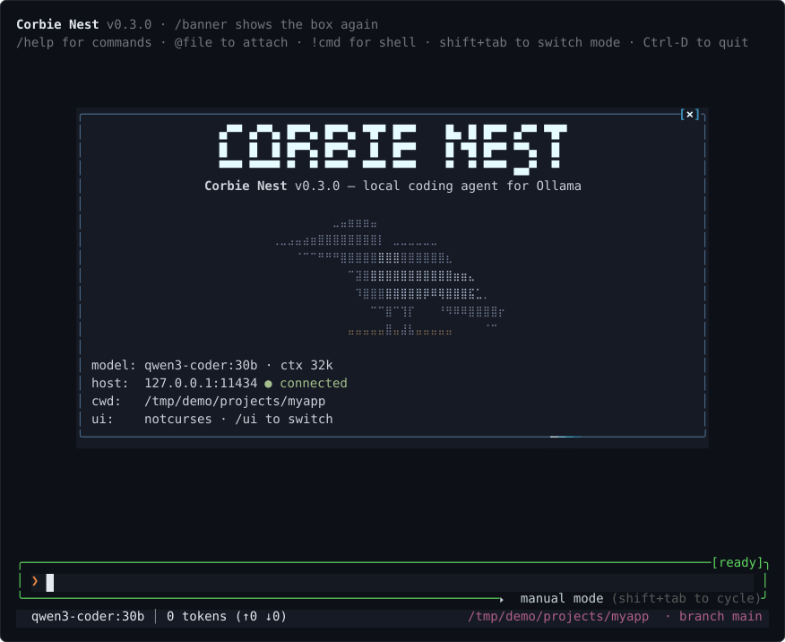

# Corbie Nest

A Claude-Code-style terminal coding agent written in plain C. It runs **local models** through
Ollama, and **hosted models** from Anthropic, xAI, OpenAI, DeepSeek and Kimi. It streams responses,
reads, writes and edits files, searches the codebase, and runs shell and git commands. Every mutating action is shown to you and
confirmed before it runs.



## Features

- **Local or hosted models.** Ollama models, or Anthropic's Claude as the model that does the work
  (`--model anthropic:claude-haiku-5-5`).
- **An advisor for cheaper models.** A stronger model can be consulted as an *advisor* (`--advisor`),
  locally, on Ollama's cloud, or through xAI, OpenAI or Anthropic. The advisor lets a weaker, much
  cheaper model do the work and get close to the performance of the frontier models: the stronger
  one is asked only for advice on the hard decisions and for reviews.
- **Tools with confirmation.** Read, write and edit files, grep, run shell and git commands,
  and look documentation up on the web. Four permission modes, from `manual` to `auto`.
- **Sub-agents.** A read-only agent investigates a question in its own context and reports
  back. A strip above the status bar lists the running ones; when they do not fit, "show all"
  opens the rest. `↓` moves into the strip and Enter opens a log.
- **Orchestration and goals.** `/orchestrate` plans a request as tasks that the advisor reviews;
  `/goal` races candidates in git worktrees against a metric.
- **Sessions, memory, skills.** Sessions resume with `--continue` or `/resume`. The project keeps
  a memory file, and skills are reusable `SKILL.md` instructions.
- **Hooks, permission rules and a sandbox.** `/hooks` runs your shell commands before and after
  tool calls and at start and stop. `deny` and `ask` rules guard bash, edit and fetch calls, and
  `sandbox=bwrap` runs the model's shell commands inside bubblewrap. Hooks are guardrails, not a sandbox.
- **More tools.** MCP servers over stdio (`/mcp`), background bash commands you can read or stop
  later, a `todo_write` task list the model keeps for a request, and stream-json input and output.
- **Providers.** Anthropic, xAI, OpenAI, DeepSeek and Kimi, and your own OpenAI-compatible hosts
  (`/model add`). Request bodies can be gzipped for the providers that accept them (`/gzip`).
- **Quiet transcript.** `/config bash hide` leaves the model's bash commands and their output out of the transcript
  (a command you are asked about still shows in the question); `/config read|grep|list|fetch|search hide` drop the
  results of `read_file`, `grep`, `list_dir`, `web_fetch` and `web_search` and keep their call lines. `show` brings each
  back; `/config` lists them.
- **Colour themes.** `/ui theme` picks a palette, shared by the terminal screen and the notcurses screen.
- **Suggested next message.** After each reply the model proposes what you would type next, as a
  muted placeholder in the field: Tab takes it, typing anything clears it (`/suggest off` turns it off).
- **Full-screen terminal UI.** A rounded input field, a status bar with the model, tokens, context
  and git branch, and a conversation with folded tool output. It also has an optional notcurses
  screen.

The complete reference is in [DOCUMENTATION.md](DOCUMENTATION.md).

## Build from source

Dependencies: a C11 compiler, `make`, [cJSON](https://github.com/DaveGamble/cJSON) and
[libcurl](https://curl.se/libcurl/) 7.66 or newer. That is all. The optional
[notcurses](https://github.com/dankamongmen/notcurses) screen is compiled in when libunistring,
zlib and terminfo (ncurses) are installed: the notcurses core is built from `vendor/notcurses`, so
no notcurses package is needed (see `vendor/notcurses/README.md`).
`make NOTCURSES=0` leaves it out in any case.

```sh
# Debian 13 (trixie) / Ubuntu 26.04 (resolute)
sudo apt install build-essential libcjson-dev libcurl4-openssl-dev

# Fedora 44
sudo dnf install gcc make cjson-devel libcurl-devel

# RHEL 10 / AlmaLinux 10 / Rocky Linux 10 (cjson comes from EPEL)
sudo dnf install epel-release
sudo dnf install gcc make cjson-devel libcurl-devel

# macOS (Homebrew; libcurl, zlib and ncurses come with macOS)
brew install cjson libunistring        # libunistring is for the notcurses screen
```

```sh
make                  # builds ./corbie
make release          # optimized, stripped binary
sudo make install     # optional: installs to /usr/local/bin
make test             # the unit tests: no model or network needed
```

Build options:
- The notcurses screen is built when libunistring, zlib and terminfo are installed. On Debian and
  Ubuntu: `sudo apt install libunistring-dev zlib1g-dev libncurses-dev` (Fedora: `libunistring-devel
  zlib-devel ncurses-devel`).
- `make NOTCURSES=0` leaves the notcurses screen out even when those libraries are installed.
- `make NOTCURSES=1` requires them and fails without them.
- On macOS, the notcurses screen is built with the steps in
  [Building with notcurses on macOS](#building-with-notcurses-on-macos).

### Building with notcurses on macOS

The notcurses screen builds on macOS as it does on Linux. Only cJSON and libunistring come from
Homebrew: libncurses (terminfo) and zlib are part of macOS.

1. Make sure the command line tools are installed (`xcode-select -p` prints their path; if it fails,
   run `xcode-select --install`).

2. Install the two Homebrew libraries:

   ```sh
   brew install cjson libunistring
   ```

3. Build with the notcurses screen required. `make NOTCURSES=1` fails when a library is missing,
   so the build does not quietly leave the screen out:

   ```sh
   make NOTCURSES=1
   ```

   The Makefile finds Homebrew through `brew --prefix` (`/opt/homebrew` on Apple silicon,
   `/usr/local` on Intel), so no flags are needed. The notcurses core in `vendor/notcurses` is
   compiled too, which takes a while the first time.

4. Start corbienest on the notcurses screen, for one run or by default:

   ```sh
   ./corbie --ui notcurses
   ```

   `/ui notcurses` switches to it during a session and saves the choice; `ui=notcurses` in the config
   makes it the default. `/ui ansi` goes back.

5. Run the unit tests on both builds, the notcurses one and the one without the screen:

   ```sh
   make NOTCURSES=1 test
   make NOTCURSES=0 test
   ```

The screen is left out when `NOTCURSES=0` is given, and `make` alone builds it whenever libunistring
and cJSON are installed.

## Quick start

1. Choose a model. Either install [Ollama](https://ollama.com), start it and pull a model with tool
   support:

   ```sh
   ollama serve
   ollama pull qwen3-coder:30b
   ```

   or export `ANTHROPIC_API_KEY` (see below). Without either, corbienest still starts: it says there is
   no model yet, and `/model` picks one once Ollama or a key is there.

2. Run corbienest in a project directory:

   ```sh
   cd your-project
   ./corbie                       # or: ./corbie --model qwen3-coder:30b
   ```

3. Type a request and press Enter. Approve each file change or command when asked.
   Type `/help` for the commands, `/mode` to change the permission mode, and `/quit` (or Ctrl-D)
   to leave.

To use Claude, export `ANTHROPIC_API_KEY`. With no model in the config and none on Ollama, corbienest
uses `anthropic:claude-opus-5` for that run (it is not saved; `/model` chooses another). To pick a cheaper
one from the start: `./corbie --model anthropic:claude-haiku-5-5`.

## Documentation

- [Usage and options](DOCUMENTATION.md#usage)
- [Slash commands](DOCUMENTATION.md#slash-commands) and [input tricks](DOCUMENTATION.md#input-tricks)
- [Permission modes and tools](DOCUMENTATION.md#permission-modes)
- [The advisor](DOCUMENTATION.md#the-advisor), [sub-agents](DOCUMENTATION.md#sub-agents),
  [orchestrating](DOCUMENTATION.md#orchestrating) and [goals](DOCUMENTATION.md#goals)
- [Skills](DOCUMENTATION.md#skills), [sessions](DOCUMENTATION.md#sessions) and
  [project memory](DOCUMENTATION.md#project-memory)
- [Configuration](DOCUMENTATION.md#config), [tests](DOCUMENTATION.md#tests) and
  [layout](DOCUMENTATION.md#layout)

## Contributing

See [CONTRIBUTING.md](CONTRIBUTING.md) for the build, test and style rules, and
[AGENTS.md](AGENTS.md) for how the code is laid out. In short: no new dependencies,
`make test` must pass, and the build must be warning-free.

## License

Apache License 2.0. See [LICENSE](LICENSE).

Copyright 2026 The Corbie Nest authors, Olav Gjerde.
